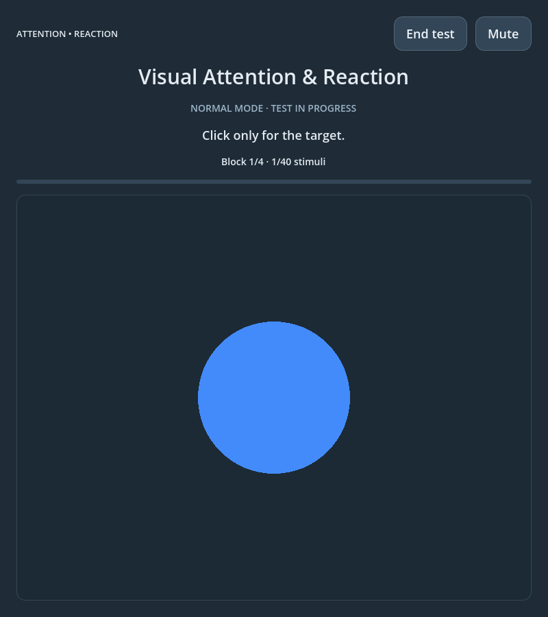

# Visual Attention & Reaction

An offline cognitive practice application built with **Godot 4.7.2** and **GDScript**. Practice sustained visual attention, recognize changing shape-and-color targets, and review response accuracy and reaction times across sessions.

**This application is intended for cognitive practice. It is not a medical diagnostic tool or a standardized clinical assessment.**



[Watch the YouTube demonstration](https://youtu.be/2i85IxDUKD8)

## Features

- Normal and Advanced modes with new targets in each block.
- Forty stimuli per session, arranged in four blocks of ten.
- Five programmatically drawn shapes and four colors, with large, responsive figures.
- Randomized stimulus order and intervals, including distractors sharing target features.
- Reaction times in milliseconds, accuracy, response outcomes, and local session history.
- Configurable presentation duration and interval bounds.
- Interface sounds and Mute/Unmute, with silent stimulus presentation and responses.
- Offline operation without accounts, analytics, network services, or external runtime dependencies.

## Modes

| Mode | Target definitions per block | Respond when… |
| --- | --- | --- |
| **Normal** | One shape-and-color combination | The displayed figure matches both the target shape and its color. |
| **Advanced** | Two distinct shape-and-color combinations | The displayed figure matches either complete target combination. |

Each block has three target presentations and seven distractors: **30% targets** over the session. In Advanced mode, both definitions appear in every block, split two appearances to one; which definition gets the extra appearance is randomized. Distractors can share a target’s shape with a different color, or its color with a different shape.

Targets change between blocks. A combination from the immediately preceding block is not reused as a new target, although an old target may subsequently appear as a distractor.

## How to play

1. Select **Normal Mode** or **Advanced Mode** on the initial screen.
2. Choose the presentation duration and the minimum/maximum blank intervals, or keep the defaults: **1 second visible**, with randomized **1–4 second intervals**.
3. Select **Start Game** and memorize the target preview shown for **3 seconds**.
4. After the **3–2–1** countdown, click anywhere in the application window when a target appears. A left mouse press or touchscreen press counts; clicking directly on the figure is unnecessary.
5. Ignore distractors. Only the first response during each stimulus counts, and the figure remains visible for its full configured duration.
6. After every ten stimuli, a **NEW TARGET** or **NEW TARGETS** announcement appears for **1.5 seconds**, followed by the next preview and countdown. The session continues automatically.
7. Review the results, repeat the test, or open **Session history**.

Preview, transition, countdown and interface-control clicks do not count. Clicking during a blank interval is a premature response. **End test** or losing application focus ends the incomplete session without saving it. Mute/Unmute remains available during the test and does not count as a response.

Presentation duration can be set from 0.5 to 5 seconds; interval bounds can be set from 0.25 to 10 seconds. The minimum interval must not exceed the maximum. There are no sounds or immediate success/error indicators during individual stimuli or responses.

## Measurements and results

| Measurement | Meaning |
| --- | --- |
| **Hits** | Target stimuli receiving a valid response. |
| **Omissions** | Target stimuli disappearing without a valid response. |
| **False alarms** | Responses to distractor stimuli. |
| **Correct rejections** | Distractors correctly left unanswered. |
| **Premature responses** | Clicks during blank intervals, counted separately. |
| **Mean / median reaction time** | Summary of valid target-response times. |
| **Fastest / slowest reaction time** | Minimum and maximum valid target-response times. |
| **Accuracy** | `(hits + correct rejections) / total stimuli × 100`. |

Reaction windows begin after Godot’s completed-render signal. Response timestamps use the monotonic microsecond clock and are converted to milliseconds; the interface displays one decimal place. Duplicate presses cannot replace the first reaction time. A response at or after the stimulus deadline cannot rescue an omission. Reaction-time summaries use **hits only**; missing values display an em dash.

Lower reaction times are useful only alongside accuracy. Compare sessions using the **same mode and timing settings**. These are software measurements: display refresh, GPU presentation, input hardware and operating-system scheduling introduce uncalibrated physical latency.

## Local session history and privacy

The latest **ten completed sessions in total** are saved on the device, newest first, with dates, mode, timing settings and statistics. History has separate **Normal** and **Advanced** views; unsupported older records are not relabelled. Loading or filtering history does not rewrite existing results.

Godot stores this application’s history at `user://sessions.json`. On a standard Ubuntu installation this resolves to:

```text
~/.local/share/godot/app_userdata/Visual Attention & Reaction/sessions.json
```

The location follows Godot’s platform conventions and `XDG_DATA_HOME` where applicable. Incomplete sessions are not saved. Save errors appear in the interface. Session history is not included in this repository or uploaded by the application.

## Requirements and installation

- **Godot 4.7.2 Standard**; the .NET edition is not required.
- A desktop environment supporting Godot’s Compatibility renderer.
- For audible Linux playback, a working audio output such as PulseAudio or PipeWire’s PulseAudio-compatible service.

Clone the project:

```sh
git clone https://github.com/domadordelvent/visual-attention-reaction.git
cd visual-attention-reaction
```

In the Godot Project Manager, choose **Import**, select `project.godot`, open the project, and press **F5**. Alternatively, if Godot is on your PATH:

```sh
godot --path .
```

The default window is 800×900 and can be resized down to 360×480. Menu, results and history screens scroll when needed. This is a standalone project; sibling cognitive games are not required.

## Automated verification

Run from the repository root with Godot 4.7.2 on PATH:

```sh
# Scheduling, both mode flows, precise response timing, statistics and history.
godot --headless --path . --script tests/run.gd

# Real rendering, mouse input, mode/history controls, shapes and resizing.
godot --path . --audio-driver Dummy --script tests/preview.gd

# Linux audio mixing, mute/unmute and silent stimuli/responses in both modes.
godot --display-driver headless --audio-driver PulseAudio --path . --script tests/audio.gd
```

The rendered suite requires a graphical display and should run sequentially with other GUI tests because changing focus ends an active test. It covers both complete four-block modes and windows at **360×480, 800×900 and 1280×720**. The audio suite uses the real system mixer and captures only the application’s UI audio bus. It does not record a microphone or modify system volume. Automated sessions write isolated temporary history files under `/tmp`, not personal session history.

The screenshot above is captured directly from the running Godot application by the rendered integration suite. The suite accelerates deadlines for verification; it does not replace the application renderer or fabricate the displayed interface. To regenerate the published image after a successful rendered test:

```sh
mkdir -p screenshots
cp /tmp/visual-attention-normal-session.png screenshots/gameplay.png
```

See [TEST_RESULTS.md](TEST_RESULTS.md) for the final verification results and limitations.

## Project structure

| File | Purpose |
| --- | --- |
| `project.godot`, `main.tscn`, `main.gd` | Application configuration, responsive interface and session state machine. |
| `targets.gd`, `stimuli.gd`, `figure.gd` | Mode definitions, randomized scheduling and programmatic geometry. |
| `responses.gd`, `statistics.gd` | First-response timestamps, classification and result calculations. |
| `history.gd` | Validated local history and mode filtering. |
| `visuals.gd` | Shared application theme and button styling. |
| `menu_audio.gd`, `default_bus_layout.tres` | Generated PCM interface cues and UI audio routing. |
| `tests/` | Automated verification and real gameplay screenshot capture. |

## Optional web export

The included Web preset uses Compatibility rendering with threads and extensions disabled. Install the matching **Godot 4.7.2 export templates**, then:

```sh
mkdir -p build/web
godot --headless --path . --export-release Web build/web/index.html
```

Serve the export over HTTP. Browser storage settings affect history persistence, and audio playback requires an initial user interaction. Web export is not part of the verified desktop release; no prebuilt binary is included.

## License

Released under the [MIT License](LICENSE).
